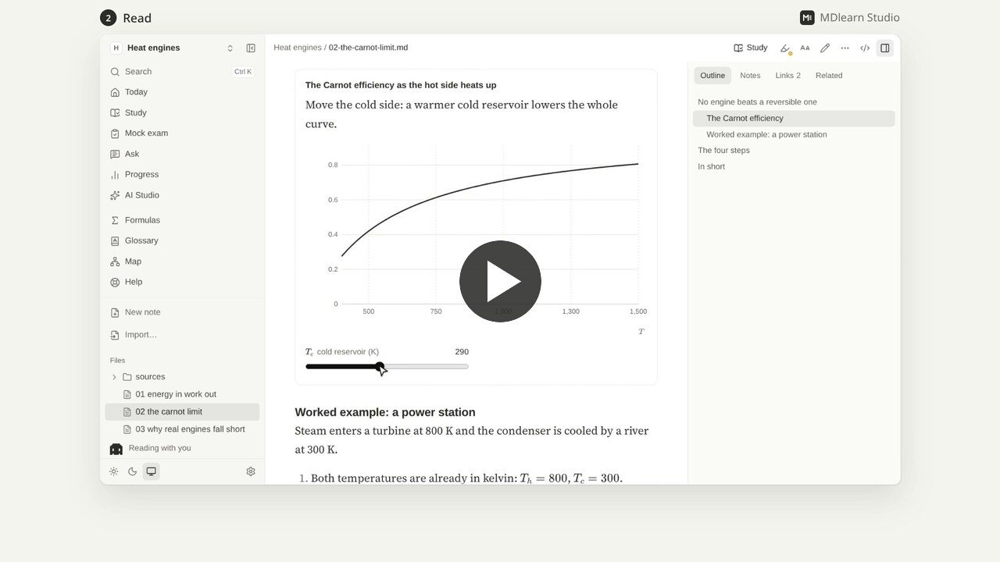
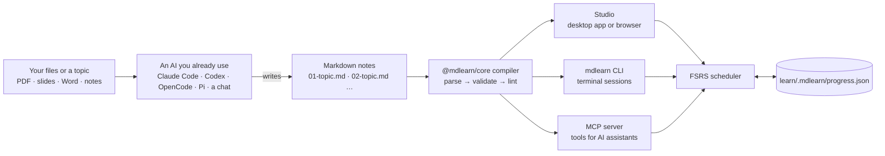
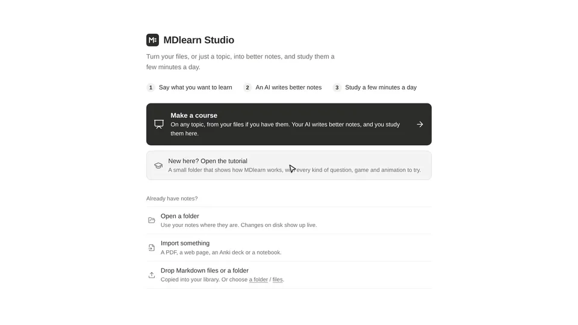
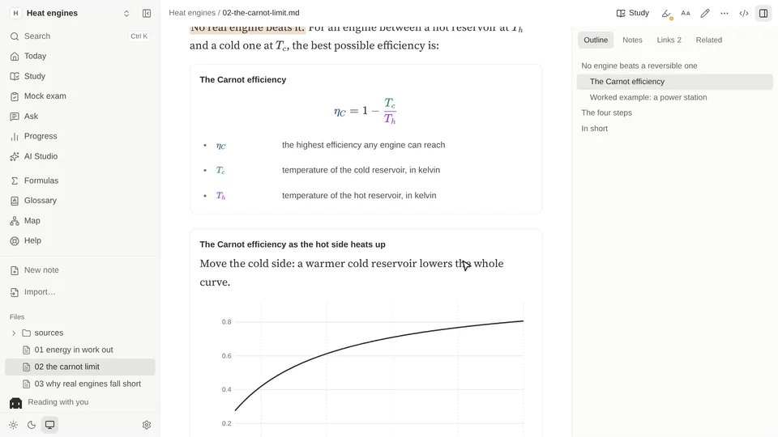
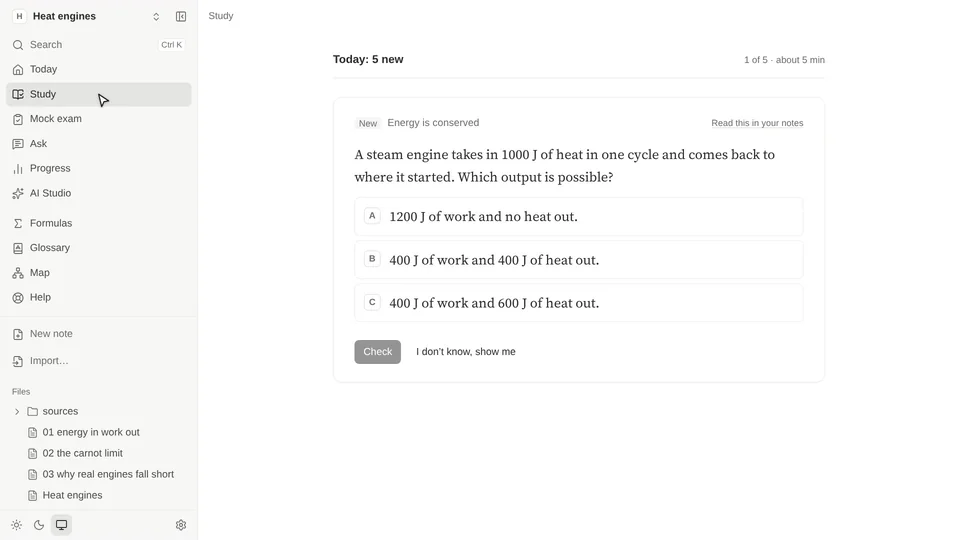
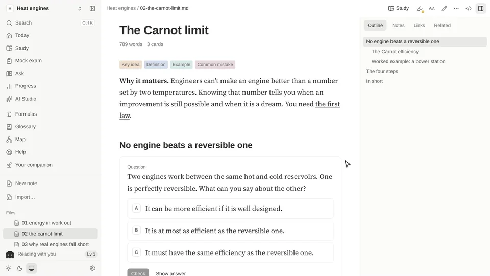

<div align="center">


# MDlearn

**Turn your class files, or just a topic, into better notes, and study them a few minutes a day.**

[](https://github.com/teo-clerk/MDlearn/actions/workflows/ci.yml)
[](https://github.com/teo-clerk/MDlearn/releases/latest)
[](https://www.npmjs.com/package/mdlearn)
[](package.json)
[](tsconfig.base.json)
[](LICENSE)

</div>

An AI you already use (Claude Code, Codex, ChatGPT…) turns your PDFs, slides and notes into Markdown notes with worked
examples, formulas, animations and exercises, and MDlearn's compiler checks every one. Spaced repetition then brings each
idea back just before you would forget it, all on your computer, with no account, in plain files you keep.

<div align="center">

[](assets/media/walkthrough.mp4)

**[Watch the walkthrough](assets/media/walkthrough.mp4)** (2:00) · [with subtitles](assets/media/walkthrough_subtitled.mp4) ·
[script](assets/media/script.md)

</div>

## Why

You have the slides, the handouts and a folder of notes, and you reread them before the exam. Rereading feels like
studying, but being tested on something does more for memory than reading it again, and seeing it again after a few days
does more than seeing it twice in one evening ([the research and its sources](docs/PEDAGOGICAL_SPEC.md)). Flashcard apps
know this, but writing good cards takes hours, and a card on its own loses the explanation around it.

MDlearn keeps both. Your notes stay notes, complete enough to learn from, and the exercises live inside them, next to the
idea they test. An AI writes them, so you don't have to, and a strict compiler holds the AI to the same rules as a careful
human author: every quiz has a right answer, every wrong option says which mistake it is, and every block must compile.

## How it works



1. **Files in.** MDlearn reads PDFs, PowerPoint and Word files, pictures, code, notebooks and data, says what it could read
   from each, and passes them, with how you want the course, to the AI you chose.
2. **Notes out.** The AI writes one Markdown file per topic. Questions, plots and animations are small blocks inside the
   text (`:::quiz`, `:::plot`, `:::animate`…), described in [the format's specification](docs/DSL_SPECIFICATION.md).
3. **Checked.** `@mdlearn/core` parses each file, validates every block and lints it. A question that doesn't compile is
   locked, never shown with its answers; `mdlearn lint` reports it with a code, and the AI fixes it.
4. **Studied.** The same core runs Studio, the terminal and the MCP server, so all three agree on what is right. Your
   answers go to an [FSRS](https://github.com/open-spaced-repetition) scheduler, kept in one progress file on your disk.

## What you get

<table>
<tr>
<td width="50%" valign="top">

**Make a course from anything.** Say what you want to learn and add any files you have, or none. Choose short or
complete, from scratch or with a base, for an exam, to understand or to look things up. Then pick who writes it:

- *Claude, from here:* runs Claude Code on your computer, and you watch it work.
- *Your coding assistant:* Claude Code, Codex, OpenCode or Pi, with one command to paste in a terminal.
- *A chat:* ChatGPT, Claude or Gemini. MDlearn gives you the prompt, and you paste the answer back.

The notes appear as they are written. Your course can change with you later: move or pause lessons, add class files,
ask for changes or a translation, and the cards you have studied keep their schedule.

</td>
<td width="50%" valign="top">



</td>
</tr>
<tr>
<td valign="top">



</td>
<td valign="top">

**Notes that teach.** Full explanations, worked examples, formulas explained term by term, plots with sliders,
step-by-step animations, diagrams, videos with questions, code that runs, and highlights whose colour says what they mark.
Nothing from your files is lost, and what the AI adds beyond them is in a note you can see.

**Reading that keeps up with technical notes:** math, tables, Mermaid diagrams, Python that runs in the page, and
your own notes beside the text.

</td>
</tr>
<tr>
<td valign="top">

**Exercises that check you.** Quizzes, fill-in-the-gaps, ordering, written answers, worked steps, code, and games
(match, sort, true-or-false rounds). You say whether you were sure *before* you see the answer, so lucky guesses come back
sooner, and what you miss comes back before the session ends.

**A short session each day.** *Today* plans it: the cards that are due, then a few new ones, with a 7-day forecast,
deadlines turned into cards per day, and the cards you keep failing.

</td>
<td valign="top">



</td>
</tr>
<tr>
<td valign="top">



</td>
<td valign="top">

**Make it yours.** Read in the font and size that suit you: serif, sans, Times, easy to read, for dyslexia or monospace.
Highlight in six colours, or mark a passage as important, confusing or for the exam; each highlight keeps a card beside
the text for your own note.

**Explain, beside the text.** Select any passage and an AI explains it in simpler words, right next to it, with room for a
follow-up question. It runs on a local model through [Ollama](https://ollama.com), or a cloud AI with your own key.

**Pixel, your study companion.** It lives at the foot of the sidebar (or an orb, or nothing: *Settings → Appearance*), grows as you finish notes and reviews (or not, if
you turn that off), and answers questions about your course in any language, showing where each answer came from and
saying when something isn't in your course.

</td>
</tr>
</table>

Also in the box:

- **Mock exams and an honest progress page:** a timed mock exam marked only at the end, teach-back (explain a section in
  your own words and get told what you missed), and the cards you were sure about and got wrong.
- **Your folder as a knowledge base:** formulas, a glossary of the terms your notes define, links and backlinks, a 2D or
  3D graph of your documents coloured by how well you remember each, related passages, and printable cheat sheets.
- **Capture, edit, import, export:** a quick inbox (Ctrl+Shift+K), a built-in editor with history, importers for web
  pages, PDFs, Anki decks, Jupyter notebooks and SciNet papers, export to Anki, and LaTeX compiled to PDF beside its source.
- **On your phone at home**, over your own network, including a few days of cards to study offline.
- **Your language:** the app comes in English, Italian, Spanish, French and Catalan. Courses can be in any language your
  AI writes.

## Install

### The desktop app

| System | File |
|---|---|
| **Windows** | `.exe` installer, or `.zip` |
| **macOS** (Apple silicon) | `.dmg`, or `.zip` |
| **Linux** | AppImage, `.deb`, or `.zip` |

Get them from the [latest release](https://github.com/teo-clerk/MDlearn/releases/latest). Nothing else is needed: no
Node.js, no terminal. The Windows installer and the AppImage update themselves.

The builds are not code-signed yet, so Windows and macOS warn you the first time. [DESKTOP.md](docs/DESKTOP.md) shows how
to open them, and each release has a `SHA256SUMS.txt` to check your download against.

### From npm, in your browser

With Node.js 22.15 or newer:

```bash
npx mdlearn studio
```

To keep the `mdlearn` command, use `npm install -g mdlearn`. If Node.js came from your system's packages, that may need
`sudo`.

### From source

This gives you the web app (`mdlearn studio`), the command line and the MCP server. You need Node.js 22.15 or newer and git.

```bash
git clone https://github.com/teo-clerk/MDlearn.git
cd MDlearn
npm install && npm run build

# put the two commands on your PATH (~/.local/bin must be on it)
mkdir -p ~/.local/bin
ln -s "$PWD/packages/cli/dist/index.js" ~/.local/bin/mdlearn
ln -s "$PWD/packages/mcp/dist/index.js" ~/.local/bin/mdlearn-mcp
mdlearn --help
```

After pulling changes, run `npm run build` again; the links keep working.

## Quickstart

### Your first course

1. Open MDlearn and choose **Make a course**. Say what you want to learn and add any files you have.
2. Say how you want it, and pick who writes it (Claude from here, your coding assistant, or a chat).
3. Read the notes as they arrive, then press **Start** on *Today*. You get one `.md` file per topic.

New here? *Open the tutorial* on the first page gives you a small sample course with every kind of question and game to
try. From a terminal, `mdlearn studio examples/showcase` opens the same thing.

### Your own Markdown notes

```bash
cd ~/my-notes          # any folder of .md files
mkdir -p learn         # lessons and your progress go here; mdlearn finds the folder from anywhere below it
mdlearn studio .       # opens http://localhost:4747 in your browser
```

Studio reads any Markdown well (math, tables, Mermaid, code, `<details>`), so it's useful before you have a single lesson.
Your notes are never modified unless you use the editor or *Insert*.

### Study from the terminal

```bash
mdlearn review         # due cards first, then up to 5 new ones (about 10 cards)
mdlearn report         # what you've seen, your accuracy, what's due and your streak
```

Type your answer and press Enter; `?` shows a hint, `s` shows the answer, `q` stops. Progress is saved after every card
and shared with Studio. **A good habit:** one short session a day, 5–10 minutes, and new lessons for what you are reading
this week rather than everything up front.

## Writing notes

A note is a Markdown file with `study: true` in its frontmatter; its exercises go to spaced repetition. Save this as
`learn/demo/01-radar.learn.md`:

```markdown
---
title: Radar basics
level: beginner
lang: en
goals:
  - State how received power depends on range
  - Compute range resolution from bandwidth
---

## Power falls with range⁴

The pulse spreads out on the way to the target and again on the way back, so the
received power falls as $1/R^4$.

:::quiz
You double the range to a target. What happens to the received power?
- [ ] It halves.
  > That would be a one-way, $1/R$ spreading, not the two-way radar case.
- [ ] It drops to a quarter.
  > That is one-way $1/R^2$ spreading; the echo spreads a second time.
- [x] It drops to a sixteenth.
  > Right: two-way spreading gives $1/R^4$, and $2^4 = 16$.
:::

## Range resolution

Two targets are told apart in range when their echoes do not overlap:
$\delta_r = c / 2B$.

:::cloze
A 50 MHz pulse gives a range resolution of {{3.0±0.1}} m.
:::
```

Then run `mdlearn lint` and fix anything it reports. Other question types (`order`, `explain`, `steps`, `code`), games
(`match`, `sort`, `speed`), visuals (`plot`, `formula`, `animate`, `sim`, sandboxed `html`), videos with checkpoint
questions (`::video`) and HTML in Markdown are described in [docs/DSL_SPECIFICATION.md](docs/DSL_SPECIFICATION.md). The
course in the walkthrough, [three notes on heat engines](assets/media/src/demo-course/), is a fuller example.

**Long, structured documents** (numbered `##` sections, like a course or a textbook chapter) work best as *companion
lessons*, which link each card to its section instead of repeating the text:

```bash
mdlearn plan 04_sar     # how the document would be split into lessons
mdlearn new 04_sar      # create those lesson files with one card per section (never overwrites)
# then fill the TODOs: AI Studio → Improve a lesson, Claude Code, or by hand
mdlearn lint            # flags cards whose ::read[§…] no longer matches the source
```

`plan` needs headings. For rough notes without them, use Claude (notes mode) or write the lesson yourself.

## Use with any AI

Ask any assistant for a course on a topic, with or without your notes; it writes MDlearn notes with the same method
Studio uses, and you study them in Studio. `mdlearn setup` prints these steps with the real paths; Studio shows them
under **Settings → Use MDlearn in other apps**.

| Where | How |
|---|---|
| **Claude Code**, any folder | Install the plugin once: `claude plugin marketplace add "/path/to/MDlearn/packages/studio/dist/integrations/claude-plugin"`, then `claude plugin install mdlearn@mdlearn`. In any project, `/mdlearn:course how vaccines work, beginner` writes a lint-checked course into that folder; `/mdlearn:study` quizzes you. The plugin brings the MCP server (one file, no setup), the four skills and the ready-made prompts `create_course`, `companion_lessons` and `study`. |
| **Codex, OpenCode, Pi**, one folder | Nothing to install: `mdlearn agents "<folder>"` (or Ctrl+K in Studio → *Get this folder ready for my AI*) writes `AGENTS.md` and `.agents/skills/`. Start the assistant there and ask for a course. `mdlearn agents --mcp` prints how to add the tools that quiz you. |
| **Claude.ai** | Upload `packages/studio/dist/integrations/mdlearn-skill.zip` under Settings → Capabilities → Skills; ask "Make an MDlearn course on …". |
| **ChatGPT, Gemini, any chat** | Paste the output of `mdlearn prompt` into the chat (or a Custom GPT's or Project's instructions; `mdlearn prompt --full` is the whole guide, to attach as a file). Then paste the chat's answer into Studio → *Import* → **From a chat**, or run `mdlearn import-chat answer.md`: every file is checked, the good ones are saved in a new course folder, and errors become a message to paste back into the chat. |

A whole course has been tested from start to finish with Claude Code and with OpenCode. Codex and Pi use the same folder
instructions, but no finished course has been confirmed with them yet.

<details>
<summary><b>Claude Code on one folder, without the plugin</b></summary>

Do this once in your notes folder so Claude Code gets the MCP tools (outline, sections, lint, the tutor) and the four
skills. Replace `/path/to/MDlearn` and `/path/to/my-notes` with absolute paths:

```bash
cat > .mcp.json <<'EOF'
{
  "mcpServers": {
    "mdlearn": {
      "command": "node",
      "args": ["/path/to/MDlearn/packages/mcp/dist/index.js"],
      "env": { "MDLEARN_ROOT": "/path/to/my-notes" }
    }
  }
}
EOF
mkdir -p .claude/skills
ln -s /path/to/MDlearn/.claude/skills/mdlearn-course .claude/skills/
for s in mdlearn-curriculum mdlearn-tutor mdlearn-visuals; do ln -s /path/to/MDlearn/skills/$s .claude/skills/; done
```

Start `claude` in the folder and approve the `mdlearn` server when asked. Then try *"quiz me on …"*, *"what is due?"*,
*"write a lesson for notes/bayes.md"*, *"fix the lint errors in learn/…"*.

</details>

The prompt lives in [docs/CHAT_PROMPT.md](docs/CHAT_PROMPT.md); `npm run build` regenerates the plugin, the skill and
the prompt files from the docs.

## Reference

### Commands

Run them inside your notes folder (or pass `--root <dir>`, or set `MDLEARN_ROOT`). Each command has `--help`.

| Command | What it does |
|---|---|
| `mdlearn studio [folder] [--port 4747] [--lan] [--lan-full] [--no-open]` | Open MDlearn Studio in the browser |
| `mdlearn review [--scope text] [--limit 10] [--new-cards 5] [--due]` | Study session (`--scope` matches a lesson id or title) |
| `mdlearn queue` · `mdlearn report` | What a session would contain · your progress |
| `mdlearn status [filter] [--all]` | Every document and how many lessons it has |
| `mdlearn outline <doc>` · `mdlearn section <doc> <§>` | A document's section map · the exact text of one section |
| `mdlearn plan <doc>` · `mdlearn new <doc>` | Plan / create companion lessons for a document |
| `mdlearn lint [file\|folder]` | Check lessons (errors and warnings; exit 1 on errors) |
| `mdlearn build <file>` · `mdlearn errata` | A lesson as JSON · corrections to the source collected from lessons |
| `mdlearn setup` · `mdlearn agents [folder] [--mcp]` | How to add MDlearn to other apps · get a folder ready for a coding assistant |
| `mdlearn prompt [--full]` | The prompt for chats without tools (`--full`: the whole guide) |
| `mdlearn import-chat <file\|-> [--to folder]` | Save the lessons a chat wrote: checked first, errors become a fix request |

`<doc>` is a path or any unique part of a file name (`04_sar`).

### Studio on your network

`mdlearn studio --lan` prints a private link and a QR code for your phone: reading, studying and notes, but no file
changes or AI jobs unless you add `--lan-full`. **Study offline** takes the next 1, 3 or 7 days of cards onto the phone and
syncs the answers when the computer is reachable again (keep the page open while offline; add it to the home screen).

### Optional extras

| You need | For |
|---|---|
| [Claude Code](https://claude.com/claude-code), signed in once | writing lessons from inside MDlearn, asking about your course without a local model, and the terminal tutor |
| [Ollama](https://ollama.com), then a model from *Settings → Local AI* | asking about a passage, explaining it, and searching your folder by meaning |
| A key for an OpenAI-compatible service (OpenRouter, OpenAI, Gemini, Groq, Mistral, DeepSeek…), in *Settings → Cloud AI* | asking, explaining and correcting without a local model |
| [Tectonic](https://tectonic-typesetting.github.io) or TeX Live | compiling `.tex` documents to PDF (`sudo pacman -S tectonic` on Arch, `brew install tectonic` on macOS) |
| [SciNet](https://github.com/teo-clerk/SciNet) running on this computer | importing papers from your library |

MDlearn runs the Claude Code you installed, under your own login, and never sees or stores that login. Your use of it is
covered by [Anthropic's terms](https://code.claude.com/docs/en/legal-and-compliance), and it's up to you to check they fit
how you use it.

### Where things are stored

| Path | What |
|---|---|
| your `.md` files | untouched (except by the editor, *Insert*, or moving an inbox item there) |
| `Inbox/YYYY-MM-DD.md` | what you captured, one file a day |
| `learn/**/*.learn.md` | lessons, mirroring your folder layout |
| `learn/.mdlearn/progress.json` | your reviews and answers, shared by Studio, terminal and Claude; **personal** |
| `learn/.mdlearn/goals.json` | daily goal, deadlines, suspended cards |
| `.mdlearn/` in the folder | Studio notes, AI job history, search index, editor history |
| `~/.config/mdlearn/studio.json` | Studio settings: recent folders, Ollama, Claude and cloud AI models |
| `~/.config/mdlearn/secrets.json` | the cloud AI's key, readable by you only |

If your notes are in git, add `.mdlearn/` to their `.gitignore`.

### Troubleshooting

| Problem | Fix |
|---|---|
| `mdlearn: command not found` | add `~/.local/bin` to your `PATH`, or check the links from *From source* |
| "No .learn.md files found" | there are no lessons yet: see *Writing notes*, and run from inside the folder that has `learn/` |
| `mdlearn plan` prints nothing | the document has no `##` sections: write the lesson with Claude or by hand |
| AI Studio says Claude Code is not installed | install Claude Code and run `claude` once to log in |
| Ask / Explain / Visualise are unavailable | start Ollama and `ollama pull qwen3:8b` (the model is set in `studio.json`) |

## Your files stay yours

MDlearn has no account, no analytics and no server of its own. Lessons, notes and progress are ordinary files on your
computer, and your notes are never changed unless you ask.

It only goes online when you do something that needs it: importing a web page, allowing a site's pictures, playing an
embedded video, downloading a local AI model, or running code that needs a Python package. The one exception is the
version check: once a day `mdlearn studio` asks the npm registry for the number of the newest version, and the desktop app
asks github.com every 6 hours (Settings → About and the app's Help menu turn them off).

When an AI writes your lessons, the files you give it go to that AI, under its own terms. When Claude answers a question,
the passages and titles it reads go to Anthropic the same way, along with your study progress if you asked the companion.
A cloud AI you set up with your own key (*Settings → Cloud AI*), or one of Ollama's cloud models, reads them the same way,
and the page says so when it answers. To keep everything on your computer, use a local model through
[Ollama](https://ollama.com) for asking and explaining.

## Documentation

| Document | What it is |
|---|---|
| [docs/PEDAGOGICAL_SPEC.md](docs/PEDAGOGICAL_SPEC.md) | The learning science behind every construct, with verified citations |
| [docs/DSL_SPECIFICATION.md](docs/DSL_SPECIFICATION.md) | The note and lesson format: syntax, formal grammar, diagnostics, companion lessons |
| [docs/ENGINE_ARCHITECTURE.md](docs/ENGINE_ARCHITECTURE.md) | Compiler, rendering, state machine, persistence, security |
| [docs/TOOLING.md](docs/TOOLING.md) | Importer, `mdlearn` CLI, `mdlearn-mcp` server, skills, a curriculum workflow |
| [docs/STUDIO.md](docs/STUDIO.md) | MDlearn Studio: architecture, AI engines and jobs, notes, visuals runtime, security, tests |
| [docs/DESKTOP.md](docs/DESKTOP.md) | The desktop app: how it is built and packaged, its security choices, opening unsigned builds |
| [docs/AGENT_SKILL.md](docs/AGENT_SKILL.md) | The authoring skill (installed as `/mdlearn-course`) |
| [CHANGELOG.md](CHANGELOG.md) | What each version brings |

## Packages

| Package | |
|---|---|
| `packages/core` | `@mdlearn/core`: Stage-0 scanner, compiler, CourseAST (Zod), checkers, importer, tutor, FSRS; `@mdlearn/core/node` for file-system helpers |
| `packages/cli` | `mdlearn`: studio, review, lint, build, status, outline, section, plan, new, queue, report, errata, setup, agents, prompt, import-chat |
| `packages/mcp` | `@mdlearn/mcp`: 15 MCP tools and 3 prompts for curriculum access, authoring and tutoring |
| `packages/studio` | MDlearn Studio: local server (Hono) and web app (React 19, Vite 8, Tailwind 4) |
| `packages/desktop` | The Electron app, with Studio's server as a sidecar |
| `skills/` | `mdlearn-curriculum`, `mdlearn-tutor` and `mdlearn-visuals` skills (plus `docs/AGENT_SKILL.md`) |

## Develop

```bash
npm install
npm run build                          # core → studio → cli → mcp (TypeScript 7)
npm test                               # Vitest: compiler, checkers, importer, tutor, MCP, Studio server
npm run typecheck
npm run check-docs                     # every example in docs/ compiles as documented
npm run test:e2e -w @mdlearn/studio    # Playwright, desktop + phone, on a temporary demo folder
npm run dev                            # Studio with hot reload
```

The walkthrough video, its subtitles and the clips above are rebuilt from [`assets/media/src/`](assets/media/src/build.sh)
with local tools only (Kokoro for the voice, Playwright, HyperFrames, FFmpeg).

## Roadmap and contributing

Where help is most welcome:

- **Signed builds.** The desktop app needs an Apple Developer ID and a Windows code-signing certificate before the first-open
  warnings go away ([DESKTOP.md](docs/DESKTOP.md)).
- **More assistants, confirmed.** Codex and Pi follow the same folder instructions as Claude Code and OpenCode, but nobody
  has confirmed a finished course with them yet. A report of a real run, good or bad, helps.
- **The tutorial in more languages.** The app speaks five languages; the sample course in `examples/showcase` is in English only.
- **Bugs from real courses.** If MDlearn reads one of your files badly or a note renders wrong, an issue with the file (or a
  small piece of it) is the fastest way to a fix.

Bug reports, ideas and pull requests are welcome: [CONTRIBUTING.md](CONTRIBUTING.md) has the setup and the few rules (tests
first, every visible string translated, a quiet interface, no invented science, dependencies at least two weeks old). For
anything large, open an issue first. To report a security problem, see [SECURITY.md](SECURITY.md).

## License

[MIT](LICENSE) © Teo Clerk.

MDlearn is an independent project. It is not made, endorsed or sponsored by Anthropic, OpenAI or the makers of the other
tools it works with. Claude and Claude Code are trademarks of Anthropic.
