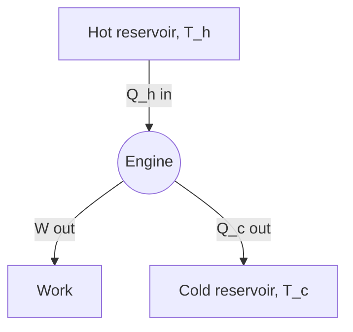

# Energy in, work out

**Why it matters.** Every car, power station and fridge runs on the same bookkeeping. By the end you can balance the
energy of any engine and say where the part it doesn't turn into work goes. You only need to know what heat and work are.

## Energy is conserved

:::quiz
A steam engine takes in 1000 J of heat in one cycle and comes back to where it started. Which output is possible?
- [ ] 1200 J of work and no heat out.
  > That makes 200 J from nothing: the first law forbids it.
- [x] 400 J of work and 600 J of heat out.
  > Right: 400 + 600 = 1000, so the energy balances.
- [ ] 400 J of work and 400 J of heat out.
  > Then 200 J would have vanished, and energy can't vanish.
:::

An engine is an energy account. What goes in must come out, as work or as heat, or stay inside as a change in its
internal energy.

Think of the gas in a cylinder with a piston. Heat it from below and two things can happen: the molecules move faster,
so the gas gets hotter, or the gas pushes the piston up and lifts a weight. Usually both happen at once. The heat you
added is split between the two, and none of it is lost along the way. Signs matter here: heat added to the gas counts
as positive, and so does work the gas does on the piston.

### The first law

The <mark data-tone="definition">internal energy</mark> of a system is the energy stored in the motion and bonds of its
molecules. The first law says how it changes:

:::formula[The first law of thermodynamics]
$$\Delta U = Q - W$$
- $\Delta U$ — change in internal energy
- $Q$ — heat added to the system
- $W$ — work done by the system
:::

<mark data-tone="rule">Energy is conserved</mark>: the change in internal energy equals the heat added minus the work
done.

### State or path

Internal energy is a <mark data-tone="definition">state function</mark>, a quantity that depends only on the state the
system is in, not on how it got there. Heat and work are not: two different routes between the same two states can
take in different heat and do different work, while $\Delta U$ is the same.

:::warning
A common mistake is to say a gas <mark data-tone="trap">"contains" heat</mark>. Heat is energy on the move, like a
payment; internal energy is the balance in the account.
:::

## What an engine is

A heat engine runs in a <mark data-tone="definition">cycle</mark>, a sequence of steps that brings it back to its
starting state. After a full cycle $\Delta U = 0$, so the first law becomes:

$$W = Q_h - Q_c$$

where $Q_h$ is the heat taken from the hot place and $Q_c$ the heat given to the cold place.

### Worked example: a small engine

An engine takes $Q_h = 2000$ J from burning fuel each cycle and releases $Q_c = 1400$ J to the air.

1. After a cycle, $\Delta U = 0$.
2. So $W = Q_h - Q_c = 2000 - 1400 = 600$ J.
3. The <mark data-tone="definition">efficiency</mark> is the share of the heat taken in that becomes work:
   $\eta = W / Q_h = 600 / 2000 = 0.30$.

:::cloze
An engine takes in 5000 J of heat per cycle and releases 3500 J. It does {{1500}} J of work, an efficiency of {{0.30}}.
:::

## In short

:::explain
Explain, as to a friend, why an engine that runs in a cycle can't turn all its heat into work.
> - After a full cycle the internal energy is back where it started.
> - So the work equals the heat in minus the heat out.
> - Some heat always leaves to the cold place, so the work is less than the heat in.
:::
